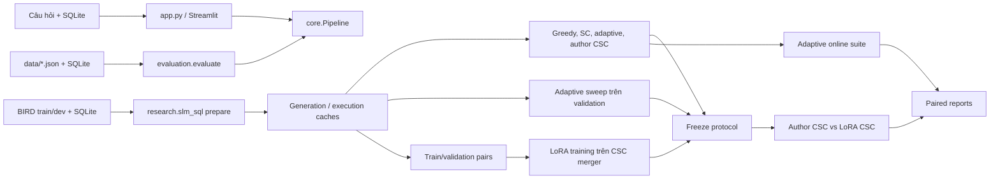

# Bản đồ cấu trúc và pipeline vận hành

> Tài liệu này mô tả code hiện có trong `SLM-PRJ`. Repo có nhiều luồng chạy phục vụ
> mục tiêu khác nhau; không nên hiểu notebook `00` đến `12` là một pipeline duy nhất.
> Luồng nghiên cứu CSC hiện hành là `09 → 10 → 11 → 12`; `00` đến `08` chủ yếu là nhánh
> legacy, tiện ích hoặc thí nghiệm bổ sung.

## 1. Bản đồ repo

```text
SLM-PRJ/
├── app.py                         Streamlit app, điểm vào demo local
├── config.yaml                    Cấu hình inference của app/evaluator
├── pyproject.toml                 Metadata, console scripts, pytest/Ruff config
├── requirements*.txt              Các profile dependency tách theo workload
├── core/                          Pipeline câu hỏi → SQL cho app/evaluation
├── databases/                     Tạo và kiểm tra SQLite mẫu
├── data/                          Câu hỏi demo/held-out; không phải dữ liệu BIRD
├── evaluation/                    EX, evaluation CLI, ablation và báo cáo
├── benchmarks/                    Loader và execution evaluator BIRD/Spider
├── research/
│   ├── slm_sql/                    CLI và pipeline nghiên cứu CSC LoRA chính
│   │   ├── adaptive_eval.py          Sweep validation và replay policy offline
│   │   └── policy_view.py             Chuẩn hóa execution votes cho policy
│   ├── policies/                   Chính sách dừng/adaptive và router
│   └── ...                         Simulator, calibration, legacy research tools
├── training/                      Data prep, SFT/LoRA, merge/export checkpoint
├── scripts/                       Smoke test, tải model, Kaggle helpers/importer
├── notebooks/                     Notebook demo, legacy và CSC 09–12
├── configs/                        Config thực nghiệm, trong đó có CSC
├── tests/                          Unit/integration tests CPU với SQLite/fake backend
└── results/                        Artifact/báo cáo runtime; phần lớn bị Git ignore
```

### Các module quan trọng

| Thành phần | Trách nhiệm |
| --- | --- |
| `core/config.py` | Đọc `config.yaml`, kiểm tra giới hạn cấu hình inference. |
| `core/model_backend.py`, `core/hf_model.py`, `core/mock_model.py` | Backend Hugging Face hoặc fixture mock. |
| `core/pipeline.py` | Điều phối đọc schema, tạo prompt, sinh ứng viên, validate, execute, sửa lỗi có giới hạn, vote và xếp hạng. |
| `core/sql_validator.py`, `core/sql_executor.py` | Cổng an toàn SQL và thực thi SQLite read-only có giới hạn. |
| `evaluation/evaluate.py` | Chạy dataset, so kết quả thực thi với gold, ghi summary/predictions. |
| `research/slm_sql/__main__.py` | CLI theo stage: prepare, generate, execute, merge, train, freeze, score/suite và report. |
| `research/slm_sql/pipeline.py` | Artifact generation/execution/adaptive/CSC có cache, provenance và resume. |
| `research/slm_sql/data.py`, `adaptation.py`, `sampling.py` | Chuẩn bị split BIRD, tạo pair train, và chấm ma trận sampling. |

## 2. Ba luồng chạy



**A. Demo local**

`app.py` nhận câu hỏi và SQLite mẫu hoặc file upload. `core.Pipeline` lấy schema,
dựng prompt, gọi backend, lọc và validate SQL, thực thi read-only, có thể sửa lỗi
trong ngân sách, rồi nhóm/xếp hạng kết quả. Backend `mock` chỉ phục vụ câu hỏi
fixture trong `data/demo_questions.json`; nó không phải phép đo chất lượng model.

**B. Evaluation của app**

`evaluation.evaluate` đọc dataset JSON có `question` và `gold_sql`, chọn DB chung
hoặc `db_path` theo record, chạy cùng `core.Pipeline` và so kết quả SQL với gold.
Gold chỉ dùng để chấm, không đưa vào prompt. `evaluation.run_ablation` chạy sáu
cấu hình trên cùng tập câu hỏi. Đây là nhánh phù hợp để kiểm tra app/model local;
nó không phải CSC merger pipeline.

**C. Nghiên cứu SLM-SQL + CSC LoRA**

`python -m research.slm_sql` là CLI nghiên cứu riêng. Generator SLM-SQL và CSC
merger của tác giả được giữ tách biệt; adapter LoRA được huấn luyện trên merger.
Notebook canonical là `09_slm_sql_baseline.ipynb` → `10_csc_lora.ipynb` →
`11_csc_evaluation.ipynb` → `12_adaptive_sampling.ipynb`. Notebook 12 chọn policy
chỉ từ validation, kiểm tra adaptive merge/replay và hiển thị bảng sampling; luồng
này dùng BIRD, cache/artifact và giao thức freeze,
không gọi `core.Pipeline` để chấm CSC.

## 3. Chạy demo và evaluation local

Yêu cầu thực tế cho app là Python 3.11/3.12. `pyproject.toml` hiện khai báo
`>=3.10`, nhưng SQLite executor cần API có từ Python 3.11; dùng 3.11 trở lên.

```bash
cd SLM-PRJ
python3.12 -m venv .venv
source .venv/bin/activate
python -m pip install -r requirements.txt
python databases/create_student_db.py
python -m pytest -q
python -m ruff check .
python scripts/smoke_test.py --backend mock --mode greedy
python -m streamlit run app.py --server.address 127.0.0.1
```

Mở `http://127.0.0.1:8501`. Trên Windows có thể dùng `scripts/run_demo.bat` sau khi
cài dependencies. `requirements.txt` là profile app/test CPU, không cài PyTorch.
Muốn chạy model thật, cài đúng wheel PyTorch CPU/CUDA cho máy, rồi cài
`requirements-model.txt`, tải weights bằng `scripts/download_model.py`, và giữ
`local_files_only: true` nếu inference cần hoạt động offline.

Evaluation local, ví dụ chạy 5 câu đầu:

```bash
python -m evaluation.evaluate --backend huggingface --device auto \
  --mode greedy --dataset data/evaluation_questions.json --limit 5 \
  --output results/local-eval
```

Kết quả gồm `predictions.jsonl`, `summary.json`, `summary.csv`, `config.json`.
Dataset benchmark ngoài phải có `gold_sql`; nếu mỗi record có `db_path`, path được
giải tương đối từ thư mục dataset. `scripts/import_bird.py` hỗ trợ chuyển dữ liệu
BIRD sang định dạng evaluator local.

## 4. Pipeline nghiên cứu CSC LoRA

### Input và dependency

BIRD không được tải tự động bởi CLI và không đi kèm repo. Thư mục evaluation cần
`dev.json` cùng `dev_databases/<db_id>/<db_id>.sqlite`; train cần
`train.json` cùng `train_databases/<db_id>/<db_id>.sqlite`. Dùng nguồn BIRD đầy đủ
phù hợp giao thức, không thay full dev bằng mini-dev nếu báo cáo kết quả final.

Inference (notebook 09/11/12) và training (notebook 10) có hai profile riêng:

- `requirements-csc-inference.txt`: vLLM/Hugging Face inference.
- `requirements-csc-training.txt`: PyTorch/Transformers/PEFT training.
- Không cài đồng thời hai profile vào một runtime Kaggle nếu không cần; chúng
  được tách để giảm xung đột giữa vLLM và stack training.

Tạo config pilot và kiểm tra đường dẫn/ngân sách trước khi bật GPU:

```bash
python -m research.slm_sql init --pilot --output configs/csc_pilot.json \
  --train-dir /path/to/bird-train --evaluation-dir /path/to/bird-dev
python -m research.slm_sql --config configs/csc_pilot.json plan
python -m research.slm_sql --config configs/csc_pilot.json prepare
python -m research.slm_sql --config configs/csc_pilot.json plan
```

Pilot mặc định giới hạn dữ liệu để kiểm tra luồng; điểm pilot không đại diện full
BIRD. `prepare` kiểm tra record/SQLite, chia train/validation theo database và giữ
evaluation tách biệt. Nếu tạm chỉ có dev, có thể chạy `prepare --evaluation-only`
để làm baseline; khi bổ sung train, dùng cùng config/experiment directory.

### Stage order

1. **Baseline inference, profile inference/GPU:**

   ```bash
   python -m research.slm_sql --config configs/csc_pilot.json sampling-baseline --seed 42
   ```

   Lệnh tổng hợp tạo/cache stochastic candidates, execution, greedy riêng,
   adaptive nếu bật, author CSC và baseline report. Các stage có artifact hoàn tất
   sẽ được kiểm tra/reuse; sai config/hash thì dừng thay vì ghi đè im lặng.

2. **Chuẩn bị dữ liệu adapter, profile inference/GPU rồi CPU:**

   ```bash
   python -m research.slm_sql --config configs/csc_pilot.json generate --split train
   python -m research.slm_sql --config configs/csc_pilot.json execute --split train
   python -m research.slm_sql --config configs/csc_pilot.json generate --split validation
   python -m research.slm_sql --config configs/csc_pilot.json execute --split validation
   python -m research.slm_sql --config configs/csc_pilot.json pairs
   ```

   Pair builder dùng train/validation artifacts; final BIRD dev không được dùng để
   tạo cặp huấn luyện. Kiểm tra pair counts và manifest trước khi dành GPU train.

3. **Huấn luyện adapter, runtime training/GPU riêng:** cài
   `requirements-csc-training.txt`, sau đó chạy:

   ```bash
   python -m research.slm_sql --config configs/csc_pilot.json train
   ```

   Adapter và manifest nằm trong `<experiment_dir>/adapter/`. Giữ nguyên cả
   experiment directory và config giữa các phiên; chỉ giữ adapter là chưa đủ để
   tái lập và kiểm tra provenance.

4. **Đóng băng protocol và final comparison, profile inference/GPU:**

   ```bash
   python -m research.slm_sql --config configs/csc_pilot.json adaptive-sweep --split validation --seed 42
   python -m research.slm_sql --config configs/csc_pilot.json freeze --seeds 42 --ks 1 2 4
   python -m research.slm_sql --config configs/csc_pilot.json sampling-final --split evaluation --seed 42
   python -m research.slm_sql --config configs/csc_pilot.json adaptive-merge --split evaluation --seed 42 --variant author
   python -m research.slm_sql --config configs/csc_pilot.json adaptive-merge --split evaluation --seed 42 --variant lora
   python -m research.slm_sql --config configs/csc_pilot.json adaptive-csc-eval --split evaluation --seed 42
   python -m research.slm_sql --config configs/csc_pilot.json report-suite --seeds 42
   ```

   `adaptive-sweep` cần fixed author/LoRA merge artifacts cho các checkpoint adaptive
   trên validation; tạo chúng bằng `merge --split validation --variant ... --k ...`
   sau khi train xong nếu cache chưa có. Policy được chọn ở đây chỉ đến từ
   validation; `adaptive-csc-eval --split evaluation` không được dùng để chọn
   threshold.

   Full study dùng config/experiment directory mới, nhiều seed đã định trước
   (thường `42 43 44`), freeze trước final LoRA predictions, chạy từng seed rồi
   aggregate. Không tune policy theo final dev EX.

### Lệnh granular và artifact

Khi cần tách stage hoặc debug, CLI có `generate`, `execute`, `greedy`, `adaptive`,
`merge`, `pairs`, `train`, `freeze`, `score`, `suite`, `report-suite` và `plan`.
Ví dụ chấm generator-only khi fixed, greedy và adaptive cache đã sẵn sàng:

```bash
python -m research.slm_sql --config configs/csc_pilot.json suite --generator-only
```

`suite --baseline-only` cần author CSC cache; `suite` comparison cần đủ author/LoRA
artifacts theo config và freeze. Nếu một lệnh tổng hợp kết thúc ở bước scoring,
đọc lỗi để biết cache upstream nào còn thiếu, chạy stage tương ứng rồi gọi `suite`
trực tiếp. Không sửa manifest bằng tay để bỏ qua kiểm tra.

Artifact chính nằm dưới `<experiment_dir>`:

| Đường dẫn | Nội dung |
| --- | --- |
| `data/manifest.json`, `data/{train,validation,evaluation}.jsonl` | Prepared splits, hash và hợp đồng dữ liệu. |
| `seed<N>/*.jsonl` cùng `*.manifest.json` | Generation, execution, adaptive và CSC outputs; có thể resume khi bị ngắt. |
| `execution_cache.sqlite` | Cache kết quả thực thi benchmark. |
| `adaptation/` và `adapter/` | Training pairs, trạng thái/weights LoRA và provenance. |
| `final_protocol.json`, `models/`, `runtime.*.json` | Freeze, checkpoint identity và runtime. |
| `adaptive/selected_policy.json` | Policy được chọn trên validation, kèm hash execution/merge artifacts. |
| `reports/` | JSON/CSV per-seed, baseline/comparison, adaptive-sweep/eval và multi-seed. |

Giữ config, prepared data, sidecar manifests, cache, adapter, model identity và
reports cùng nhau. `results/` phần lớn Git-ignored; cần tự lưu/di chuyển artifacts
qua session Kaggle. CLI không tự upload dữ liệu/weights; helper Hub chỉ chạy khi
được yêu cầu cấu hình rõ.

## 5. Notebook và nhánh phụ

| Notebook/nhánh | Vai trò hiện tại |
| --- | --- |
| `00`–`08` | Setup/data prep/Qwen SFT và các thí nghiệm legacy; không cần cho nghiên cứu CSC chính. |
| `09_slm_sql_baseline.ipynb` | Preflight, baseline sampling/author CSC, cache train/validation. |
| `10_csc_lora.ipynb` | Tạo pairs và huấn luyện adapter trên CSC merger. |
| `11_csc_evaluation.ipynb` | Freeze, so author với LoRA, multi-seed report; không gọi generator lại. |
| `12_adaptive_sampling.ipynb` | Chọn policy validation, adaptive merge/replay và bảng sampling online/offline. |
| `training/`, `research/` ngoài `slm_sql` | Utilities cho data prep, checkpoint, simulator, calibration, legacy protocols; chọn đúng workflow trước khi chạy. |

Notebook 09–12 dùng helper `scripts/csc_notebook.py` để chọn config, cài profile,
chạy CLI và tùy chọn publish/restore adapter riêng tư. Notebook không thay thế việc
lưu nguyên experiment folder.

## 6. Kiểm tra và giới hạn

- Bộ test CPU dùng SQLite thật và backend giả; chạy `python -m pytest -q` sau khi
  cài `requirements.txt`. Test không chứng minh chất lượng model thật.
- Ruff dùng `python -m ruff check .`; `pyproject.toml` loại riêng notebook legacy
  `00`–`08` khỏi lint vì chúng dùng state xuyên cell và không thuộc pipeline hiện
  hành. Notebook `09`–`12`, source và test vẫn được kiểm tra. Notebook có thể kiểm
  tra JSON/Python cells riêng; việc compile không chứng minh GPU runtime thành công.
- Chưa có GitHub Actions workflow trong repo; hiện chưa có CI tự động build/test.
- `Dockerfile` đóng gói app Streamlit và profile `requirements.txt` cho demo CPU;
  không cài PyTorch, vLLM, CSC training dependencies, BIRD hay weights. Đây không
  phải image cho research pipeline.
- Full BIRD/weights/GPU là prerequisite cho kết quả nghiên cứu thật. Smoke test
  mock chỉ xác nhận đường đi phần mềm trên fixture.
- Cấu hình app (`config.yaml`) và CSC (`configs/csc_experiment.yaml`) là hai schema
  khác nhau, không dùng thay thế cho nhau.

## 7. Lối vào nhanh

- Chạy giao diện local: `scripts/run_demo.bat` (Windows) hoặc `python -m streamlit run app.py`.
- Kiểm tra backend/luồng app không tải weights: `python scripts/smoke_test.py --backend mock --mode greedy`.
- Đánh giá app: `python -m evaluation.evaluate --help`.
- Xem các stage CSC: `python -m research.slm_sql --help`.
- Xem quy trình CSC chi tiết và Kaggle: [CSC_LORA.md](CSC_LORA.md),
  [KAGGLE.md](../KAGGLE.md), [NOTEBOOKS_00_11.md](NOTEBOOKS_00_11.md).
